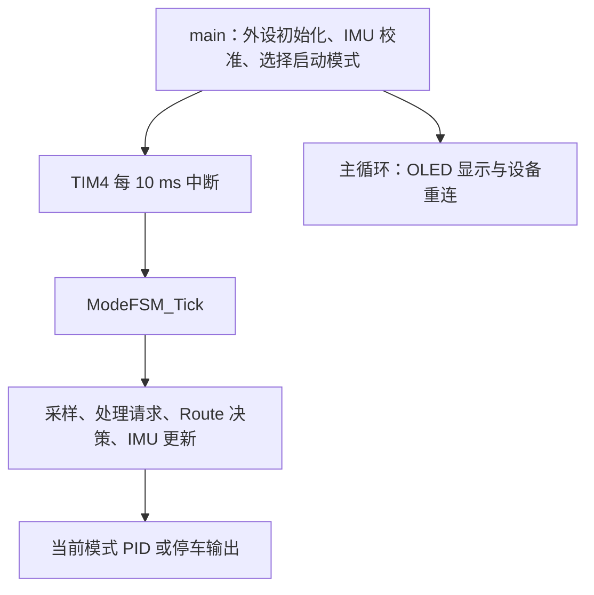
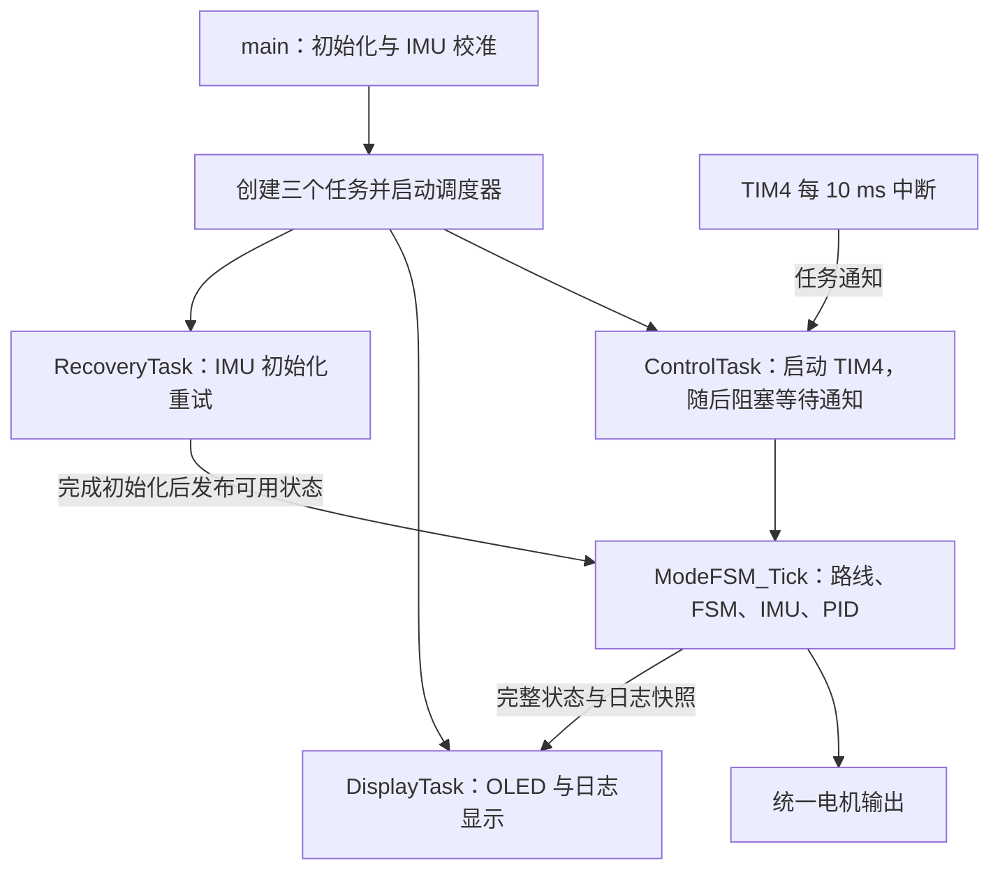

# 全地形小车 FreeRTOS 改造方案与实施报告

日期：2026-10-20  
状态：已完成源码迁移、Keil 构建与迁移专项测试，待板上验证  
阅读对象：项目开发者；用于理解移植步骤、核对任务职责和逐步实施

## 1. 方案结论

已在新建的 `FR` 分支接入用户提供的 **FreeRTOS V10.5.1**。当前实现三个应用任务：`ControlTask`、`DisplayTask`、`RecoveryTask`。

核心做法是把现有的整帧运动控制从 TIM4 中断搬入 `ControlTask`，保留帧内执行顺序；TIM4 每 10 ms 只通知任务。OLED 与设备恢复从主循环移到各自任务。FreeRTOS 负责调度，现有 FSM 继续管理循迹、IMU 直行、转弯与停车。

本次已经复制内核、配置 Keil、迁移控制和前台业务，保留现有路线表、PID 参数、启动测试开关和路线结束行为。没有提交、推送或烧录固件。各模块职责及配置见下文，实际验证结果见第 8 节。

## 2. 改造前工程基线

本节记录实施前 `Road` 分支、提交 `340a327` 的状态，作为前后对照；不描述迁移后的当前运行入口。

| 项目 | 当前情况 |
|---|---|
| Git 基线 | 分支 `Road`，提交 `340a327`；编写报告前工作区干净，尚无本地 `FR` 分支 |
| 硬件与编译器 | STM32F103RC，Cortex-M3，系统时钟 72 MHz；Keil ARM Compiler 5.06 update 7 |
| 工程内存范围 | Keil 配置 SRAM 48 KiB、Flash 256 KiB |
| 控制入口 | TIM4 每 10 ms 进入 `HAL_TIM_PeriodElapsedCallback()`，直接调用 `ModeFSM_Tick()` |
| 路线处理 | `Route_Tick()` 位于 `ModeFSM_Tick()` 内，与动作接受和 PID 在同一帧执行 |
| IMU 处理 | 运行且处于 IMU 模式时读取六轴、解算姿态；普通循迹期间不持续读取 IMU |
| 前台工作 | OLED 每 100 ms 显示；OLED 和 IMU 不可用时分别按 1 s 间隔重试 |
| 现有控制结构 | `Car_*()` 提交单槽请求；FSM 统一接受动作，同帧停车优先 |
| RTOS 接入情况 | 当前小车工程尚未接入 FreeRTOS |

改造前执行关系：



关键源码入口：

- [主程序及当前前台流程](E:/Embedded_Development/All-terrain/ALL_terain_For_11/Core/Src/main.c)
- [运动状态机与当前 TIM4 回调](E:/Embedded_Development/All-terrain/ALL_terain_For_11/App/Mode_FSM/Mode_FSM.c)
- [MPU6050 初始化与采样](E:/Embedded_Development/All-terrain/ALL_terain_For_11/Int/Int_MPU6050/Int_MPU6050.c)
- [Keil 工程配置](E:/Embedded_Development/All-terrain/ALL_terain_For_11/MDK-ARM/ALL_terain_For_11.uvprojx)

## 3. 三个任务怎样分工

### 3.1 总体结构

| 任务 | 优先级 | 执行时机 | 承担的工作 | 初始栈空间 |
|---|---:|---|---|---:|
| `ControlTask` | 3 | TIM4 每 10 ms 通知唤醒 | 执行完整运动帧，维护路线、FSM 和控制器，输出电机 PWM | 512 个 `StackType_t`，即 2048 字节 |
| `DisplayTask` | 2 | 每 100 ms 处理一次 | OLED 初始化、状态和日志显示；失败后按 1 s 间隔重连 | 768 个 `StackType_t`，即 3072 字节 |
| `RecoveryTask` | 1 | 每 1 s 检查一次 | IMU 不可用时执行初始化重试 | 384 个 `StackType_t`，即 1536 字节 |

任务优先级数值越大，优先级越高。空闲任务由内核创建，优先级为 0，不计入三个应用任务。上述栈值是初始分配值，最终需要用板上栈水位确认。



### 3.2 ControlTask：整帧控制的唯一执行者

控制任务每次被 TIM4 唤醒后调用一次 `ModeFSM_Tick()`，保留以下顺序：

1. 清除上一帧的 IMU 有效标志，采样八路灰度。
2. 第一次取请求：接受此前提交的外部动作，并记录本帧是否接受停车。
3. 执行 `Route_Tick()`：更新路口条件、路线阶段，必要时提交一个新动作。
4. 第二次取请求：让路线本帧动作立即生效；已接受停车的帧不能再次接受运动动作。
5. 检查限时直行结束条件；仅在需要 IMU 控制时进行六轴读取、姿态解算及转弯判断。
6. 停车或故障时输出零 PWM；运行时只选择循迹、IMU 直行、IMU 转弯中的一种控制器。

正常运行时，只有该任务调用会驱动电机的控制路径。显示和恢复任务不能调用 PID 或直接写 PWM。内核致命错误的应急停车属于独立异常出口，应只做最小的零 PWM 处理。

`Track_Task`、`IMU_Task` 中的 `Task` 目前表示算法模块，不代表已经存在 FreeRTOS 任务。本版继续由同一个控制任务调用它们，避免多个任务同时控制电机。

路线暂不独立成任务：现有 `Route_Tick()` 依赖本帧灰度和 FSM 状态，且能够当帧提交动作。保留它在控制任务内，可以保留单帧路口事件和两次取请求的时序，减少实车行为变化。

### 3.3 DisplayTask：统一管理 OLED

把 OLED 初始化、100 ms 显示和 1 s 重连集中到显示任务，OLED 由该任务独占。主程序继续初始化 I2C1 外设，但不再维护 OLED 前台循环。

显示仍调用现有 `DebugLog_Display()`。它先在短临界区复制运动、路线与日志，再恢复中断，随后格式化和执行 I2C 通信。OLED 故障只影响显示；成功重连后重绘，不清空日志、不解除运动故障。

正常刷新使用 `vTaskDelayUntil()` 保持 100 ms 周期，任务应在处理完成后阻塞。OLED 初始化中的现有短延时首版可以保留在该低优先级任务内，不能移入控制任务或中断。

### 3.4 RecoveryTask：恢复通信，保留故障停车

恢复任务每 1 s 检查一次 `g_imu_ready`。只有 IMU 不可用时才调用现有初始化函数，不周期性复位正常设备。

本版采用以下访问顺序，避免两个任务同时操作 MPU6050 的软件 I2C：

- 需要执行 IMU 控制时，若 `g_imu_ready=0`，控制任务按现有故障路径停车，不访问 MPU6050；普通循迹不因这个标志为 0 而自行停车，也不访问 MPU6050。
- 初始化期间始终保持该标志为 0；全部寄存器配置和 I2C 操作结束后，驱动最后发布为 1。
- 恢复任务只调用 `Int_MPU6050_Init()`，不在返回后再次执行 `g_imu_ready = 返回值`。这样可以避免控制任务抢占并报告新故障后，被恢复任务写回旧的成功结果。
- 共享就绪标志的声明、定义与测试替身统一使用 `volatile`；该限定只保证可见性，互斥依赖上述访问顺序。

现有初始化内部的 `HAL_Delay(100)` 先保留。它在低优先级任务中执行，中断保持开启，控制任务能够抢占；不能在该延时期间屏蔽中断或挂起整个调度器。若以后新增第二个 IMU 访问者，需要重新设计同步，不能继续沿用单标志约定。

初始化成功仅表示通信恢复。运动故障、路线中止和停车状态继续保留，必须通过显式新动作或从起点重新启动路线来恢复。运行时不自动重新校准陀螺零偏；上电校准流程保持原样。

## 4. FreeRTOS 文件和配置

### 4.1 使用哪份源码

使用用户提供的本地文件，不混用此前讨论的 STM32Cube 内核版本：

- [FreeRTOS V10.5.1 内核目录](E:/Embedded_Development/keil_project/RTOS/17HAL_Key_soft_tim/FreeRTOS/)
- [配置文件来源](E:/Embedded_Development/keil_project/RTOS/17HAL_Key_soft_tim/Core/Inc/FreeRTOSConfig.h)

内核已复制到 `E:/Embedded_Development/All-terrain/ALL_terain_For_11/FreeRTOS/`，工程配置位于 `E:/Embedded_Development/All-terrain/ALL_terain_For_11/Core/Inc/FreeRTOSConfig.h`。没有复制示例的按键任务、软件定时器演示或 HAL 定时器时间基准文件。

Keil 第一版添加五个源文件：`source/tasks.c`、`source/list.c`、`source/queue.c`、`portable/RVDS/ARM_CM3/port.c`、`portable/MemMang/heap_4.c`。其他功能源码本版不参与编译。

在 Keil 的 `Options for Target → C/C++ → Include Paths` 追加：

```text
..\FreeRTOS\include
..\FreeRTOS\portable\RVDS\ARM_CM3
```

这两项以 Keil 工程所在的 `MDK-ARM` 目录为基准；原有 `Core/Inc` 包含路径继续使用。

### 4.2 配置取值

| 配置项 | 本版取值 | 用途 |
|---|---|---|
| `configUSE_PREEMPTION` | `1` | 高优先级控制任务及时获得 CPU |
| `configCPU_CLOCK_HZ` | `72000000UL` | 匹配当前系统时钟 |
| `configTICK_RATE_HZ` | `1000` | RTOS 节拍为 1 ms |
| `configMAX_PRIORITIES` | `5` | 任务优先级可取 0～4 |
| `configMINIMAL_STACK_SIZE` | `128` | 空闲任务等所用的最小栈深度，单位为 `StackType_t` |
| `configTOTAL_HEAP_SIZE` | `12 * 1024` | `heap_4` 管理的初始堆空间 |
| `configUSE_16_BIT_TICKS` | `0` | 使用 32 位节拍计数 |
| `configUSE_TASK_NOTIFICATIONS` | `1` | TIM4 通知控制任务 |
| `configUSE_TIMERS` | `0` | 三任务方案不需要软件定时器任务 |
| `INCLUDE_xTaskGetSchedulerState` | `1` | SysTick 判断调度器是否启动 |
| `INCLUDE_vTaskDelay` | `1` | 普通阻塞延时 |
| `INCLUDE_xTaskDelayUntil` | `1` | 固定周期执行，供 `vTaskDelayUntil()` 使用 |
| `INCLUDE_uxTaskGetStackHighWaterMark` | `1` | 上板检查剩余栈空间 |
| `configCHECK_FOR_STACK_OVERFLOW` | `2` | 开启栈溢出检查，配套提供故障钩子 |
| `configUSE_MALLOC_FAILED_HOOK` | `1` | 分配失败时进入应急停车，配套提供故障钩子 |

从示例复制配置时，用 `INCLUDE_xTaskDelayUntil` 替换旧的 `INCLUDE_vTaskDelayUntil`，不要同时定义两者。配置钩子开启时必须同时实现对应函数；钩子和 `configASSERT` 的故障出口不显示 OLED、不调用阻塞接口，只做应急停车并保留可调试状态。

三个应用任务的初始栈合计为 6656 字节。12 KiB 堆还要容纳任务控制块和空闲任务等，不能把任务栈总和当成全部 RTOS 开销。最终以链接映射、创建结果和板上高水位为准。

### 4.3 三个中断入口怎样接

| 中断或异常 | 改造方式 |
|---|---|
| SVC | 配置 `vPortSVCHandler` 映射到 `SVC_Handler`，注释掉原有空函数定义 |
| PendSV | 配置 `xPortPendSVHandler` 映射到 `PendSV_Handler`，注释掉原有空函数定义 |
| SysTick | 保留 `HAL_IncTick()`；调度器启动后再调用 `xPortSysTickHandler()` |
| TIM4 | 每 10 ms 调用 `vTaskNotifyGiveFromISR()`，按需要执行 `portYIELD_FROM_ISR()`；不运行运动算法 |

SysTick 同时维护 HAL 与 FreeRTOS 的 1 ms 时间。启动调度器前只更新 HAL 时间，保证 IMU 初始化和校准中的延时正常工作。不要把 `xPortSysTickHandler` 直接映射成 `SysTick_Handler`，否则会与自定义的组合入口冲突。

中断优先级配置采用 4 位抢占优先级分组：

| 项目 | 数值 |
|---|---:|
| TIM4 的 HAL 中断优先级 | 5 |
| `configLIBRARY_MAX_SYSCALL_INTERRUPT_PRIORITY` | 5 |
| `configLIBRARY_KERNEL_INTERRUPT_PRIORITY` | 15 |
| `configMAX_SYSCALL_INTERRUPT_PRIORITY` | `5 << 4`，即 `0x50` |
| `configKERNEL_INTERRUPT_PRIORITY` | `15 << 4`，即 `0xF0` |

示例原来的系统调用优先级上限为 191，在此芯片上对应优先级 11，不能原样用于优先级 5 的 TIM4 通知。任务优先级是数值越大越高；Cortex-M 中断优先级是数值越小越紧急。其他高紧急程度中断保持原职责，不调用 FreeRTOS API。[官方 Cortex-M 中断配置说明](https://www.freertos.org/Documentation/02-Kernel/03-Supported-devices/04-Demos/ARM-Cortex/RTOS-Cortex-M3-M4)

## 5. 文件与启动流程安排

已在 `E:/Embedded_Development/All-terrain/ALL_terain_For_11/App/RTOS/` 新增任务目录，文件职责如下：

| 文件 | 职责 |
|---|---|
| `App_RTOS.c`、`App_RTOS.h` | 创建任务、保存控制任务句柄、提供中断通知入口和内核故障钩子 |
| `Control_Task.c` | `ControlTask()`：启动 TIM4、等待通知、执行控制帧与节拍检查 |
| `Display_Task.c` | `DisplayTask()`：管理 OLED 初始化、刷新和重连 |
| `Recovery_Task.c` | `RecoveryTask()`：IMU 初始化重试 |

主要接口安排：

- 新增 `AppRTOS_Start()`：在主程序完成必要初始化和启动动作选择后调用；创建全部任务并启动调度器，任何创建失败都保持停车。
- 新增 `AppRTOS_ControlTickFromISR()`：封装 TIM4 到控制任务的通知；仅在调度器和任务句柄有效时使用。
- `Car_*()`、`Route_Tick()`、`ModeFSM_Tick()`、`DebugLog_Display()` 保留已有调用语义；修改相关中文注释，使其准确说明新的任务上下文。

启动顺序固定为：HAL 和时钟 → GPIO、PWM、TIM4 配置、串口及 I2C 外设初始化 → 电机与控制器初始化 → IMU 初始化和静止校准 → 按原有开关选择一次启动请求 → 创建全部任务 → 启动调度器 → 控制任务启动 TIM4。

原主循环中的显示与重连代码迁移后不再重复执行。TIM4 回调从运动模块移到 RTOS 接入模块，避免基础算法模块直接依赖 FreeRTOS，也避免多个同名回调。

## 6. 分阶段实施与验收

| 阶段 | 实施内容 | 通过条件 |
|---|---|---|
| 1：建立基线 | 从当时的当前工作状态创建 `FR`，记录源码与测试基线 | 现有修改保留；不自动提交、不自动推送 |
| 2：接入内核 | 复制内核、加入 Keil 分组和包含路径、配置节拍及异常入口 | 工程可完整构建，无新增编译错误或警告 |
| 3：验证调度 | 暂不启动路线和 TIM4；用临时测试任务每 100 ms 增加计数器 | 调度器持续运行，计数器和 `HAL_GetTick()` 正常增长 |
| 4：迁移控制 | 用控制任务执行原 `ModeFSM_Tick()`，TIM4 只负责通知 | 中断不再采样或驱动电机，每次有效唤醒只执行一帧 |
| 5：迁移前台 | 加入显示与恢复任务，移除主循环的重复业务执行 | OLED 重连和 IMU 恢复不会重复调度动作或自动续跑路线 |
| 6：验证整车 | 依次验证架空车轮、纯循迹、限时 IMU 直行、路线运行 | 实测周期、控制效果和故障停车符合原功能及新增节拍要求 |

临时调度测试只在移植过程使用；最终恢复原有启动模式选择，不新增长期测试开关。移植期间先保持电机停车，进入运动验证后先架空车轮，再放到原测试道路。

当前已完成阶段 1、2、4、5 的源码实现及软件验证。阶段 3 的真实调度运行和阶段 6 的周期、栈水位、整车效果需要上板确认，宿主任务替身不能替代这两阶段。

### 6.1 保留行为的回归场景

- 停车请求不能被同帧运动请求覆盖；外部动作能够接管并中止自动路线。
- 灰度采样、第一次请求接受、路线决策、第二次请求接受和 PID 输出的顺序保持不变。
- 同一帧只执行一种运动控制；普通循迹时不额外运行 IMU 角度 PID。
- 限时直行、转弯完成确认、转弯超时和路线结束行为保留原含义。
- IMU 读取失败时保存故障现场并停车，不用旧角度继续输出。
- OLED 失败与重连保留日志、冻结现场及真实运动故障。
- IMU 重连期间不发生软件 I2C 交错；就绪状态不会被过期的恢复结果覆盖。

### 6.2 新增的实时性检查

控制任务使用计数型通知：等待时采用 `ulTaskNotifyTake(pdTRUE, portMAX_DELAY)`，正常一次取到一个通知。[官方任务通知说明](https://www.freertos.org/Documentation/02-Kernel/02-Kernel-features/03-Direct-to-task-notifications/01-Task-notifications)

若一次取到多个通知，或用 DWT 测得单个控制帧耗时达到 10 ms，就不能连续补跑 PID。规划增加控制节拍故障 `CAR_FAULT_CONTROL_PERIOD`，由控制任务调用新的 `ModeFSM_ControlPeriodFault()` 捕获现场、锁存故障并输出零 PWM，同时清除故障发生前尚未接受的运动请求，防止旧请求在下一帧重新启动。之后保留故障停车，故障后的显式新动作才允许重新尝试；若下一帧继续超时，再次停车。该策略用于暴露失去周期保证的状态，不代表能够预防所有 CPU 卡死情形。

板上同时观察任务唤醒间隔、单帧最大耗时和栈高水位。10 ms 是执行周期，不代表可以把整段 10 ms 全部用完；测试中应确认存在稳定余量。

### 6.3 验证结果怎样记录

分别记录三类证据：

1. **宿主测试**：验证动作顺序、状态转换、通知积压处理和故障逻辑。将原“TIM4 回调直接执行控制”的断言更新为“回调只通知、任务执行控制”；基础运动测试仍可直接驱动 `ModeFSM_Tick()`。
2. **Keil 完整构建**：验证目标编译器、移植层、符号映射和内存布局，检查任务创建所需资源。
3. **板上与实车**：验证周期、软件 I2C 在任务调度下的稳定性、栈水位、轮向、循迹、转向和路线衔接。

本机原 MinGW 编译器仍有 DLL 重定位启动错误，本次改用已安装且可运行的 CLion GCC 15.2.0 执行专项。编译器无法启动与测试断言失败分别记录；Keil 编译成功也不能代替实车验证。

## 7. 当前交付与后续边界

当前交付包括三个任务入口、内核源码、配置、Keil 工程、专项测试与本报告。三个任务、12 KiB 堆和初始栈分配均已写入源码；任务栈是否充足及实际控制时序仍需板上测量。[任务运行、调试及测试命令说明](E:/Embedded_Development/All-terrain/ALL_terain_For_11/App/RTOS/README.md)

实施时按阶段推进，每阶段只增加理解和验证当前功能所需的内容。第一版不拆出独立路线任务或独立 IMU 采样任务，不增加地图搜索、自动故障续跑、命令队列或新的路线配置体系。后续是否继续拆分，应依据新的实际需求和控制周期测量结果判断。

## 8. 本次验证记录

| 验证项目 | 结果与证据 |
|---|---|
| 分支与源码基线 | 已从 `Road` 的 `340a327` 创建并切换到 `FR`；原报告保留，没有提交或推送 |
| Keil 构建 | ARM Compiler 5.06 update 7，最终 0 Error(s)、0 Warning(s)，生成 AXF 和 HEX |
| 固件大小 | Code=34844、RO-data=3772、RW-data=476、ZI-data=15436 字节；静态 RAM 合计 15912 字节，约 15.5 KiB，包含内核堆 |
| 真实任务入口专项 | 通过：三个任务创建参数、TIM4 只通知、SysTick 调度前后计时、通知积压、恰好 10 ms 截止、DWT 回绕、OLED 初始化/刷新失败重连、IMU 过期成功值不写回 |
| 真实运动专项 | 默认九段、全部段、截止八段分别编译并通过；覆盖节拍故障立即停车、旧请求清除、冻结现场、显式恢复、路线收尾与中止 |
| 日志与姿态回归 | 独立日志测试和真实姿态解算测试通过 |
| 旧全量回归 | 未通过，且迁移前基线已经存在同类不一致：断言循迹 PWM=400，当前源码为 500；旧第九段断言入口/通行 1000/5000 ms，当前表项为 1300/3000 ms。本次保留车辆参数，没有把专项通过写成旧全量通过 |
| 板上与实车 | 未执行，不能据软件结果判断控制余量、栈水位、I2C 稳定性或路线通过能力 |

Keil 在沙箱内无法启动 ARMCC，本次用沙箱外本机构建完成验证。最终重建期间有一次驱动 `.crf` 浏览信息文件写入错误，未改驱动源码；重编译失败单元后链接成功。该次文件输出问题与固件源码诊断分开记录。

当前两个启动测试开关仍为 0，校准成功后按原路线启动。首次下载验证应架空车轮，观察 `g_rtos_stats.control_max_us`、三个 `*_stack_free_words` 和 `control_period_faults`，再进行原道路测试。
